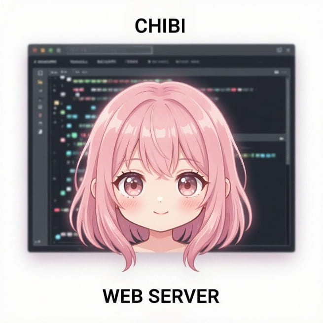

<p align="center">
  
</p>

<h1 align="center">ChibiWebServer</h1>

<p align="center">
  <strong>A high-performance multi-threaded web server and Reverse Proxy gateway with native OpenSSL TLS termination</strong>
</p>

<p align="center">
  <a href="#-supported-architectures">Architectures</a> •
  <a href="#-installation-and-deployment">Deployment</a> •
  <a href="#-automated-background-execution-systemd-service">Background Service</a> •
  <a href="#-critical-architectural-design-virtual-hosting--directory-layout">Directory Layout</a> •
  <a href="#-built-in-interactive-testing-dashboard">Testing Dashboard</a> •
  <a href="#-native-ssl-generation-via-certbot-multi-domain-setup">SSL Generation</a> •
  <a href="#-detailed-configuration-file-breakdown-chibiconf">Configuration</a>
</p>

---

* 💻 **Platforms & Architectures:** 
  * `x86_64` &nbsp;&nbsp; (Intel / AMD Linux Clouds & Enterprise Servers) — *Statically linked*
  * `ARM64 (aarch64)` &nbsp;&nbsp; (AWS Graviton, Raspberry Pi, ARM-based Cloud Instances) — *Statically linked*
* 🔒 **Encryption Core:** &nbsp;&nbsp; ` Native OpenSSL TLS Layer (Hardware-level TLS Termination) `
* 🌐 **Network Architecture:** &nbsp;&nbsp; ` Non-blocking Full-Duplex I/O Pipeline (sys/select Multiplexing) `

---

**ChibiWebServer** is an ultra-fast, production-grade lightweight web server and HTTP Reverse Proxy gateway engineered from scratch in pure C++17. Distributed as pre-compiled, fully self-contained static binary packages, it requires zero external dependencies or shared libraries on the host machine.

The engine features an isolated POSIX thread pool (`RunPool`), an asynchronous character-by-character HTTP header stream parser, and a high-throughput full-duplex transit pipeline. It natively handles hardware TLS-termination, streams heavy chunked network payloads seamlessly (including Git-over-HTTPS push commits up to 17+ MB into local Gitea instances), and isolates execution pathways for distributing WebAssembly (WASM) modules.

### ⚡ Multi-Architecture Autonomy
All distributed production binaries are **completely statically linked (`-static`)**. They encapsulate all critical cryptography and runtime assets directly inside the binary payload. This guarantees flawless execution across disparate environments—ranging from legacy enterprise Linux server distros to minimal Alpine Docker micro-containers—entirely eliminating shared library mismatches or missing `.so` dependency errors.

---

## 📦 Supported Architectures

Official production packages are compiled into independent static binaries with embedded OpenSSL algorithms:
* **x86_64** (Standard Intel/AMD modern architectures for Cloud environments and bare-metal nodes).
* **ARM64 / aarch64** (Advanced energy-efficient ARM cloud server nodes, AWS Graviton instances, and Raspberry Pi targets).

---

## 🚀 Installation and Deployment

System deployment on a target host machine is fully managed by the accompanying universal automation script.

### Step 1: Download the Release Archive
Navigate to the **Releases** tab of this GitHub repository and fetch the tarball archive tailored to your target hardware layout:
* `chibiwebserver_linux_x86_64_v0.1.tar.gz`
* `chibiwebserver_linux_arm64_v0.1.tar.gz`

### Step 2: Extraction and Automated Installation
Unpack the release assets directly on your server host. Running the installer macro automatically evaluates your CPU architecture type, copies the matching binary asset, renames it to a clean system identifier, and registers it globally:

```bash
# Extract the binary distribution package
tar -xf chibiwebserver_linux_*.tar.gz
cd chibiwebserver

# Run the smart installer (copies asset to /usr/local/bin, renames it to 'chibiwebserver', and assigns privileges)
sudo make install
```

*To cleanly purge the web server executable from system paths at any time, simply execute:* `sudo make uninstall`

---

## ⚠️ Critical Architectural Design: Virtual Hosting & Directory Layout

ChibiWebServer is strictly engineered as a **Virtual Hosts (Multi-Domain) web server**. The local filesystem lookup path for serving static files is resolved dynamically by evaluating the incoming HTTP `Host` header sent by the client browser:
`Target Path = global_site_folder / incoming_host_header / requested_subpath`

When deploying or testing the application locally, the requested host identifier is established by the literal entry type typed inside your browser's address field.

### Practical Scenario: Mapping a Site to `localhost:9000`

To launch your web server instance bound to port `9000` and cleanly distribute a specific local web application whenever an individual hits `http://localhost:9000`, structure your folders as follows:

1. **Establish the Host Directory:** Inside your primary asset storage root (the `global_site_folder` parameter, which defaults to `public`), provision a subfolder named exactly after your destination host trigger — in this instance, **`localhost`**.
2. **Deploy Production Assets:** Position all individual site fragments (`index.html`, style arrays, JS structures) inside that newly allocated `localhost` directory.

**Standard Production Directory Blueprint:**
```text
your_server_workspace/
├── chibi.conf     (Primary server configuration layout)
└── public/        (Global site asset directory root)
    └── localhost/ <-- Virtual Host folder matching your local domain target
        ├── index.html
        ├── css/
        └── js/
```

3. **Initialize the Server Daemon:** 
   * When loading via **`chibi.conf`**, verify that `global_port = 9000` is active and that `site = localhost` is registered under the virtual hosts segment.
   * When loading via **raw CLI flags**: `chibiwebserver 9000 public logs -v`. The engine automatically intercepts the folder tree under `public/localhost`. If you need the web application to map across literal IP accesses (`http://127.0.0.1:9000`), simply rename or duplicate your host folder asset to **`default`**.
---

## ⚙️ Automated Background Execution (Systemd Service)

To run ChibiWebServer as a robust background daemon that automatically boots on system startup, recovers from failures, and operates strictly under a specific non-root user configuration, you should configure a Linux **Systemd** service unit.

### Step 1: Create the System Service File
Create a new service configuration asset inside the system directory:

```bash
sudo nano /etc/systemd/system/chibiwebserver.service
```

Paste the following production-ready service layout configured to isolate execution under **`user0`**:

```ini
[Unit]
Description=ChibiWebServer High-Performance Multi-threaded Daemon
After=network.target

[Service]
Type=simple
# Ensure the working directory points to your production deployment folder where 'chibi.conf' resides
WorkingDirectory=/etc/chibiwebserver
ExecStart=/usr/local/bin/chibiwebserver --config chibi.conf
Restart=always
RestartSec=5s

# Graceful termination timeout (gives the RunPool thread manager time to drain active client sockets)
TimeoutStopSec=10s

# Security Enhancements: Run as specific unprivileged user and pull essential supplementary group contexts
User=user0
Group=user0
SupplementaryGroups=user0
AmbientCapabilities=CAP_NET_BIND_SERVICE

[Install]
WantedBy=multi-user.target
```

### Step 2: Establish the Production Environment Paths
Since the service is configured to run under your local profile, you must provision the target runtime folders and assign correct ownership flags to keep it accessible:

```bash
# 1. Provision the system configuration path
sudo mkdir -p /etc/chibiwebserver

# 2. Copy your 'chibi.conf' and your 'public/' folder tree into the deployment route
sudo cp chibi.conf /etc/chibiwebserver/
sudo cp -r public /etc/chibiwebserver/

# 3. Provision the system log route
sudo mkdir -p /etc/chibiwebserver/logs

# 4. Assign complete operational ownership to your profile
sudo chown -R user0:user0 /etc/chibiwebserver
```

### Step 3: Manage the Daemon Lifetime
Reload the system supervisor engine to index the new service asset, activate the boot trigger, and fire up your web server:

```bash
# Force systemd to scan the newly added service unit
sudo systemctl daemon-reload

# Activate the boot-time auto-start hook
sudo systemctl enable chibiwebserver

# Fire up the server daemon immediately
sudo systemctl start chibiwebserver

# Check the live application state and runtime kernel logs
sudo systemctl status chibiwebserver
```

### Useful Maintenance Commands:
* **Stop the Server:** `sudo systemctl stop chibiwebserver`
* **Restart the Server (Apply configuration edits):** `sudo systemctl restart chibiwebserver`
* **Inspect Live Daemon Streams:** `sudo journalctl -u chibiwebserver.service -f -n 100`

---

## 🕹️ Built-in Interactive Testing Dashboard

To allow developers to instantly evaluate the core capabilities of the server engine, the repository comes equipped with a pre-configured **Interactive Testing Dashboard** located directly inside the `public/localhost` directory. 

This panel serves as a live baseline to verify that the server is working correctly. It can be launched flawlessly either on your local development machine (`localhost`) or deployed onto a remote production VPS to test live capabilities.

### Core Functions & Capabilities of the Dashboard:

#### 1. Thread-Safe POST Request (`/api/submit`)
* **Purpose:** Tests the internal API handling and thread safety of the server engine.
* **Operation:** You can input a custom username (e.g., `ChibiDeveloper`) and a message status. Clicking **"Send POST"** routes the payload directly to the server's `/api/submit` endpoint. 
* **Under the Hood:** The server safely locks thread execution via `std::mutex` and permanently appends the data record into `users.txt` inside your configured logs directory with an automated timestamp.

#### 2. GET Parameters URL Parsing (`?key=val`)
* **Purpose:** Demonstrates query string separation.
* **Operation:** Clicking the **"Inject ?user=Chibi&theme=dark"** interactive trigger appends parameters directly to the address layout.
* **Under the Hood:** The `HttpRequest` class splits and parses the incoming keys and values into an internal map on the fly without breaking or interrupting standard static file asset serving.

#### 3. Dynamic Payload Volume Stress-Test
* **Purpose:** Tests hardware traffic filters and request body constraints.
* **Operation:** Select a specific payload size from the menu: **16 MB**, **32 MB**, **64 MB**, **128 MB**, **256 MB**, **512 MB**, or **1 GB (1024 MB)**, then click **"🚀 Test"**.
* **Under the Hood:** The dashboard transmits a large synthetic data clump via a POST request. If the file chunk exceeds the host's runtime limit configured by `max_body_size` (or the CLI `-m` flag), the server instantly drops the connection and returns a `413 Payload Too Large` error.

#### 4. Live Network Response Console
* **Purpose:** Live telemetry debugging.
* **Operation:** Displays incoming data, execution processing speeds, headers, and HTTP status codes in real-time. Includes a **"Clear Console"** macro to flush historical entries.

### How to Launch the Dashboard:
1. Ensure your workspace directory contains the `public/localhost` structure with the dashboard files.
2. Spin up the server using either the CLI manual parameters or the configuration mapping file.
3. Open your destination web browser and navigate to `http://localhost:9000` (or your remote server's IP/domain address).
---

## 🔒 Native SSL Generation via Certbot (Multi-Domain Setup)

To activate hardware-level HTTPS encryption on ChibiWebServer, you must provision valid TLS certificate pairs. The most efficient way to secure multiple distinct domains or subdomains simultaneously is by issuing a single **Multi-Domain (SAN - Subject Alternative Name) Certificate** via Certbot. 

### Step 1: Install Certbot on Linux
Ensure your host machine is updated and install the standalone Certbot tool via your system's package manager:

```bash
# Update local package definitions
sudo apt update

# Install Certbot core utility
sudo apt install certbot -y
```

### Step 2: Generate a Multi-Domain (SAN) Certificate
Stop ChibiWebServer if it is already running (to free up port 80), and run Certbot in `--standalone` mode. You can pass multiple `-d` flags to bind all your target domains into a single physical certificate asset:

```bash
sudo certbot certonly --standalone -d example1.com -d example2.com -d ://example1.com
```

#### ⚠️ Critical Certificate Resolution Rule:
When issuing a multi-domain certificate, Certbot always creates the physical directory and saves the `.pem` files **strictly under the name of the very first domain** specified in your command (in this case, `/etc/letsencrypt/live/://example1.com`). 

The alternative domains passed afterwards (`example2.com`, `://example1.com`, etc.) do **not** get their own directories. Instead, they are completely embedded inside that first certificate payload. Therefore, in your `chibi.conf` file, all separate virtual host entries must point to the exact same physical folder path belonging to that primary domain:

```text
# For example1.com:
ssl_cert = /etc/letsencrypt/live/://example1.comfullchain.pem
ssl_key  = /etc/letsencrypt/live/://example1.comprivkey.pem

# For example2.com (Points to the exact same primary path!):
ssl_cert = /etc/letsencrypt/live/://example1.comfullchain.pem
ssl_key  = /etc/letsencrypt/live/://example1.comprivkey.pem

# For ://example1.com (Points to the exact same primary path!):
ssl_cert = /etc/letsencrypt/live/://example1.comfullchain.pem
ssl_key  = /etc/letsencrypt/live/://example1.comprivkey.pem
```

### Step 3: Configure Linux File Permissions for `user0`
By default, Let's Encrypt directories restrict read access to anyone except the root user. To allow the unprivileged process running under **`user0`** inside systemd to successfully open and process the certificates via OpenSSL, change the folder group ownership and grant read permissions to the group:

```bash
# 1. Assign group ownership of the Certbot structure to the user0 group
sudo chown -R root:user0 /etc/letsencrypt

# 2. Grant traversal (execute) permissions to the user0 group for the directory tree
sudo chmod 0750 /etc/letsencrypt
sudo chmod 0750 /etc/letsencrypt/live
sudo chmod 0750 /etc/letsencrypt/archive
sudo chmod 0750 /etc/letsencrypt/live/YourDomain
sudo chmod 0750 /etc/letsencrypt/archive/YourDomain

# 3. Grant explicit read privileges to the .pem certificate payloads
sudo chmod 0640 /etc/letsencrypt/live/YourDomain/*.pem
sudo chmod 0640 /etc/letsencrypt/archive/YourDomain/*.pem
```

---

## 🛠️ Detailed Configuration File Breakdown (`chibi.conf`)

The configuration topology is bifurcated into two independent segments: **Global Server Settings** (low-level socket constraints and thread pool sizes) and **Virtual Hosts Blocks** (modular routing rules defined per specific domains).

Below is the standard, production-ready configuration blueprint detailing the practical impact of every parameter:

```text
# ======================================================================
#               CHIBIWEBSERVER AUTOMATED CONFIGURATION
# ======================================================================

# ----------------------------------------------------------------------
# [GLOBAL SERVER SETTINGS] — Main Kernel Parameters
# ----------------------------------------------------------------------

# 1. Listening Network Port
# Defines the exact TCP port bound by the socket listener during startup.
# Options: 9000 or 8080 (Local debugging), 80 (Standard HTTP), 443 (Standard HTTPS TLS).
# Note: Root privileges (sudo) are strictly required to bind ports below 1024.
global_port = 9000

# 2. Main File System Asset Root
# The primary workspace directory where the server dynamically looks for domain folders.
global_site_folder = public

# 3. System Log Output Directory
# The destination directory where the server commits 'access.log' data and API records ('users.txt').
# If missing, the filesystem engine will automatically attempt to provision it during startup.
global_logs_dir = logs

# 4. Verbose Operations Toggle
# When configured to 'true', the server engine operates in trace mode, printing complete 
# incoming HTTP header data, client IPs, traffic counters, and proxy tunnels to stdout and logs.
global_verbose = true

# 5. Global POST Request Size Constraint (In Megabytes)
# The default maximum threshold applied to incoming data payloads (forms, binary uploads) 
# if not explicitly overridden inside a virtual host block. Defends RAM from Out-Of-Memory exploits.
global_max_body_size = 10

# 6. Worker Thread Pool Allocation Size
# The absolute quantity of concurrent POSIX worker threads instantiated inside RunPool at startup.
# Governs the capacity of simultaneous persistent sockets the engine can process in parallel.
global_threads_count = 64


# ----------------------------------------------------------------------
# [VIRTUAL HOSTS CONFIGURATION] — Multi-Domain Declarations
# ----------------------------------------------------------------------
# A block is strictly initialized by the 'site' parameter. Subsequent arguments (enabled, 
# max_body_size, ssl_cert, ssl_key, proxy_pass) bind to the host declared immediately above them.

# --- VIRTUAL HOST 1: Local Static & Testing Suite ---
# Maps the testing suite environment directly onto standard unencrypted local traffic loops.
site = localhost
enabled = true          # Toggle availability: true (online), false (returns a 403 Forbidden page)
max_body_size = 0       # 0 represents an unlimited payload scale (disables upload boundaries for this host)

# --- VIRTUAL HOST 2: Production Static & High-Load WASM Distribution ---
# Sets up a live external domain bound to explicit SSL paths and optimized for heavy asset distribution.
site = example1.com
enabled = true
max_body_size = 128     # Strictly constrains file uploads to a maximum scale of 128 Megabytes

# OpenSSL Native TLS-Termination Assets
# Points to the absolute paths of the certificate assets generated via Let's Encrypt Certbot.
# If these fields are omitted or commented out, the virtual host defaults to unencrypted HTTP Only.
ssl_cert = /etc/letsencrypt/live/://example1.comfullchain.pem
ssl_key  = /etc/letsencrypt/live/://example1.comprivkey.pem

# --- VIRTUAL HOST 3: High-Throughput Reverse Proxy Gateway ---
# Re-routes traffic dynamically. Inbound packets hit the SSL layer for termination, and the raw 
# HTTP stream is transparently channeled down to a microservice socket over local backplane connections.
# NOTE: Points to the 'example1.com' folder due to the Certbot multi-domain certificate grouping rule.
site = ://example1.com
enabled = true
max_body_size = 0       # 0 is vital here to prevent connection drops during large Git push uploads (17+ MB)
ssl_cert = /etc/letsencrypt/live/://example1.comfullchain.pem
ssl_key  = /etc/letsencrypt/live/://example1.comprivkey.pem

# Destination Backend Application Mapping
# Specifies the exact backend service listener (e.g., a local Gitea instance or a Node.js daemon).
# ChibiWebServer initializes a non-blocking Full-Duplex pipeline via select() between the external user and this port.
proxy_pass = http://127.0.0.1:3000
```

---

## 📜 License

This project is licensed under the terms of the MIT open-source license.  
*Designed, developed, and optimized by: **Edward Numbless**.*
